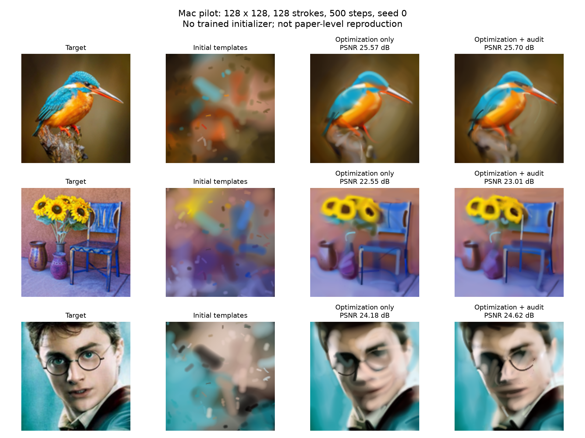
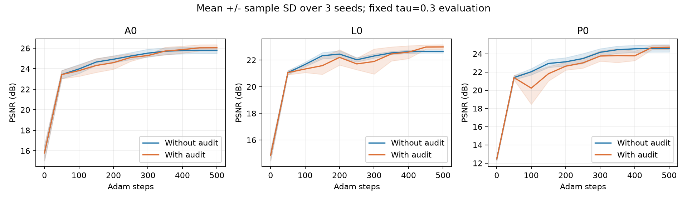

<div align="center">

<h1>Quadratic Bezier Splatting with Structural Initialization for Efficient Painting Rendering [Reproduction]</h1>

<p><strong>Analytic curves · Differentiable painting · Stroke auditing</strong></p>

<p>Independent implementation · Reproducible evidence · Transparent limitations</p>

<p>
<a href="https://arxiv.org/abs/2611.10713"></a>


<a href="https://github.com/gulucaptain/Quadratic-Bezier-Splatting-Reproduction/actions/workflows/tests.yml"></a>
<a href="LICENSE"></a>
</p>

<p><a href="https://arxiv.org/abs/2611.10713">📄 Paper</a> · <a href="docs/results.md">📊 Results</a> · <a href="docs/method.md">📐 Method</a> · <a href="docs/experiments.md">🧪 Protocol</a></p>

</div>

## 🎯 Reproduction at a glance

| | Scope & evidence |
|:--|:--|
| 🧩 **Implemented** | Analytic Bézier rendering, stroke auditing, adaptive optimization and initializer architecture. |
| 🧪 **Validated locally** | Three-image, three-seed paired pilot · 18 runs · CPU/MPS numerical checks. |
| 🔎 **Remaining gaps** | No completed learned-initializer training, full benchmark or paper-equivalent CUDA speedup. |

> [!IMPORTANT]
> This is an independent, partial reproduction—not the authors’ official implementation. Local experiments do not establish full paper-result reproduction.

---

**Independent PyTorch implementation of analytic stroke rendering and audit-guided optimization, with CPU and Apple Silicon support.**

[Paper](https://arxiv.org/abs/2611.10713) · [Method correspondence](docs/method.md) · [Experimental protocol](docs/experiments.md) · [Results](docs/results.md)

This repository implements components of *Quadratic Bezier Splatting with Structural Initialization for Efficient Painting Rendering* by Jinfan Liu, Xuhan Zhan, Mengqin Zhao, Guangyi Deng, Wuze Zhang, and Bingbing Ni. The NeurIPS 2026 listing uses the prefix *Stroke-Audited*.

**Status: partial reproduction.** The analytic renderer, stroke auditing, adaptive optimizer, and an independently reconstructed initializer architecture are implemented. Released experiments use random multiscale templates, not a trained initializer. They do not reproduce the paper's full-resolution benchmark results or CUDA speedups. This is not the authors' official implementation.



*128 × 128 images, 128 strokes, 500 optimization steps, seed 0. The learned initializer is not used.*

## 🧩 Features

- Analytic point-to-quadratic-Bézier distance with cubic-root selection and explicit line/point degeneracy handling.
- Differentiable front-to-back alpha compositing with conservative tile culling and optional gradient recomputation.
- Per-stroke support, purity, net benefit, and residual-demand measurements.
- Pruning, de Casteljau splitting, and residual-driven respawning with persistent optimizer state for surviving strokes.
- Multiscale structure-tensor direction regularization.
- ViT-small initializer with three cascaded query groups; training and checkpoint-resume entry points.
- Configured matched-seed experiments, raw traces, floating-point stroke exports, and reproducible summary generation.

## ⚙️ Installation

Python 3.10 or later is required; the recorded experiments used Python 3.12.13. Run the commands below from the repository root.

```bash
git clone https://github.com/gulucaptain/Quadratic-Bezier-Splatting-Reproduction.git
cd Quadratic-Bezier-Splatting-Reproduction
python3 -m venv .venv
source .venv/bin/activate
python -m pip install --upgrade pip
python -m pip install -e '.[dev]'
```

For the recorded macOS dependency versions, install with constraints:

```bash
python -m pip install -c requirements-lock.txt -e '.[dev]'
```

The lock file records the original experiment environment, not a universal cross-platform lock. CPU execution is supported for reference checks. Apple Silicon experiments use `--device mps`; an unavailable MPS backend raises an error rather than silently falling back. Other accelerators are not validated by this release.

## 🚀 Quick start

Download the three evaluation inputs from the upstream Im2Oil repository. The downloader verifies immutable URLs and SHA-256 digests from [the manifest](data/manifest.json).

```bash
qbs-prepare-data
qbs-fit --image data/gallery/A0.jpg --out runs/example \
  --device mps --width 128 --height 128 --strokes 128 \
  --steps 500 --seed 0 --audit full
```

Use `--device cpu` for CPU execution. Each run exports:

| File | Contents |
|---|---|
| `config.json` | Arguments, device, runtime versions, input digest, source digests, audit thresholds |
| `trace.jsonl` | Step, MSE, PSNR, stroke count, elapsed time |
| `initial.png`, `best.png`, `final.png` | Initial, selected, and final reconstructions |
| `strokes.npz` | Floating-point parameters for the selected and final stroke sets |
| `audit.npz` | Per-stroke audit statistics of the selected reconstruction |
| `metrics.json` | Image metrics, timing, snapshot selection, and edit-event counts |

An existing nonempty output directory is rejected. Use a new directory or explicitly pass `--overwrite`. `--help` lists all fitting options.

## 🔁 Reproduce the released experiments

The [pilot configuration](configs/pilot.json) defines three images, three seeds, and two audit conditions: 18 runs in total.

```bash
qbs-suite --config configs/pilot.json --root runs/pilot --device mps
qbs-report --root runs/pilot --out runs/report
```

Completed runs are reused only when their arguments and core source digests match. Use `--force` to recompute them. The figure layout in `qbs-report` is designed for the canonical three-image pilot.

To rebuild the published numerical summary **without running optimization or downloading images**:

```bash
qbs-report --root results/pilot --out runs/report --no-figures
python scripts/verify_results.py
```

To regenerate the figures, run `qbs-prepare-data` first and omit `--no-figures`. Source images are not distributed as dataset files.

The long-run configuration uses 5,000 steps and disables auditing during the last 500:

```bash
qbs-fit --image data/gallery/A0.jpg --out runs/long_A0_s0_full \
  --device mps --steps 5000 --audit-tail 500 --log-every 100
```

Stored strokes can be rendered at a new resolution without refitting:

```bash
python -m qbs.rerender --strokes results/long_A0_s0_full/strokes.npz \
  --out runs/bird_512.png --device mps --width 512 --height 512
```

## 📊 Results

Paired local evaluation, averaged over three images and three seeds:

| Method | PSNR ↑ | SSIM ↑ | Runtime per image ↓ |
|---|---:|---:|---:|
| Template initialization + optimization | 24.3504 dB | 0.7619 | 22.18 s |
| Template initialization + optimization + audit | 24.5812 dB | 0.7681 | 22.61 s |

Auditing increased PSNR in **8 of 9 pairs**, with a mean difference of **+0.2309 dB**. One pair decreased by 0.0951 dB; it remains included in the statistics. These are descriptive results on three selected images, not a statistical generalization claim. LPIPS was not measured.



Hardware: Apple M4 Pro, 48 GiB unified memory, 16-core GPU, macOS 15.7.1, PyTorch MPS. See [per-image results, scaling measurements, and limitations](docs/results.md), [CSV](results/pilot_summary.csv), and [raw run records](results/pilot).

## 📐 Method and reproduction scope

A stroke stores three 2D control points, RGB color, half-width, and opacity. The renderer selects the nearest analytic curve parameter and differentiates the distance at that selected parameter. Visible contributions are accumulated front-to-back. The audit measures each stroke's incremental reconstruction benefit and reallocates available capacity through deletion, splitting, and respawning.

The [method document](docs/method.md) maps equations to functions and separates specified behavior from implementation assumptions. Important limitations include:

- No completed Flickr2K training and no released pretrained initializer.
- No complete multi-patch/global inference and paper-scale budget-growth pipeline.
- Several audit thresholds, depth assignments, curvature priors, and direction-field settings are not uniquely specified by the paper.
- `--audit split` has no effect when initialized at full capacity; it is **not** a reproduction of the paper's Split Only ablation.
- No complete DIV2K/Gallery evaluation, six-method baseline comparison, LPIPS, material renderer, or user study.
- The tiled PyTorch implementation does not reproduce the CUDA renderer optimizations or the reported 220.3× speedup.

## 🧠 Initializer training

Check the end-to-end training path on a synthetic image:

```bash
qbs-train --smoke --out runs/train_smoke --device mps \
  --batch-size 1 --strokes 30 --render-size 64 --max-steps 5
```

This checks finite, nonzero gradients; it does not establish training convergence. For training on separately acquired Flickr2K images:

```bash
qbs-train --data data/flickr2k --out runs/flickr2k --device mps \
  --epochs 200 --batch-size 32 --microbatch 1 --strokes 250 --render-size 256
```

Gradient accumulation preserves the effective batch size. Resume with `--resume runs/flickr2k/checkpoint.pt` and the same training arguments. The complete training schedule has not been executed in this release. Crop policy, initialization, and checkpoint restrictions are documented in [the experiment protocol](docs/experiments.md).

## ✅ Tests and development

```bash
pytest -q
ruff check qbs tests
ruff format --check qbs tests
python -m qbs.verify_mps  # Apple Silicon only
```

Tests cover an independent polynomial-root distance oracle, finite-difference gradients, degenerate curves, float32 stability, tiled compositing, checkpointed gradients, de Casteljau geometry, direction invariance, and audit scheduling. GitHub Actions runs the CPU test suite and checks that published summaries can be reconstructed from raw records.

## 🗂️ Repository structure

```text
qbs/          Renderer, optimizer, initializer, training and evaluation commands
configs/      Versioned experiment definitions
tests/        Numerical and scheduling tests
scripts/      Published-result verification
docs/         Method correspondence, protocols and result interpretation
data/         Download manifest; acquired images are ignored
results/      Curated experiment records and figures
runs/         New local outputs (ignored)
```

## 📚 Citation and license

Please cite the original paper when using its method:

```bibtex
@misc{liu2026quadratic,
  title={Quadratic Bezier Splatting with Structural Initialization for Efficient Painting Rendering},
  author={Jinfan Liu and Xuhan Zhan and Mengqin Zhao and Guangyi Deng and Wuze Zhang and Bingbing Ni},
  year={2026},
  eprint={2611.10713},
  archivePrefix={arXiv},
  primaryClass={cs.CV},
  url={https://arxiv.org/abs/2611.10713}
}
```

Software citation metadata is provided in [CITATION.cff](CITATION.cff). Original implementation code is distributed under the [MIT License](LICENSE). The paper, third-party data, and source images retain their respective rights; see [NOTICE](NOTICE).

---

## 🧭 Reproduction collection

Independent research implementations with recorded configurations, experimental evidence and explicit limitations.

| Project | Focus |
|:--|:--|
| [Directional Stationarity](https://github.com/gulucaptain/Directional-Stationarity-Reproduction) | Nonsmooth optimization |
| **Quadratic Bézier Splatting** · this project | Stroke-based rendering |
| KoalaGS · local project; repository pending | Continuous Gaussian LoD |
| [PhySPRING](https://github.com/gulucaptain/PhySPRING-Reproduction) | Physics-informed graph reduction |
| [MatrixSplat](https://github.com/gulucaptain/MatrixSplat-Reproduction) | Matrix-based Gaussian rendering |
| [SimuScene](https://github.com/gulucaptain/SimuScene-Reproduction) | Scene geometry and physics |
