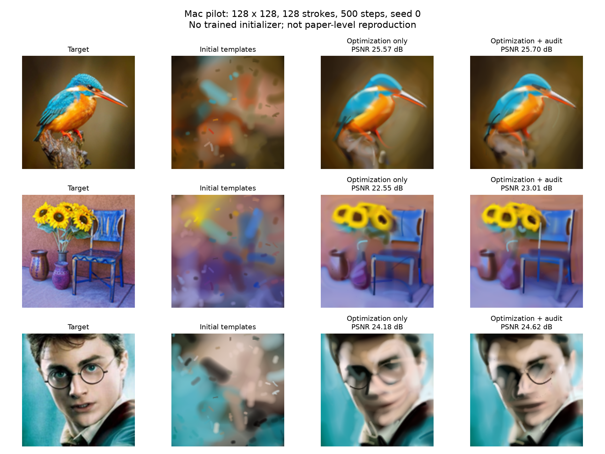
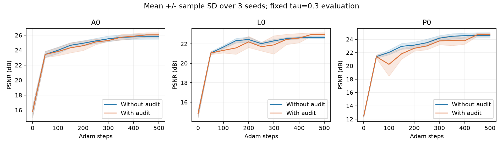
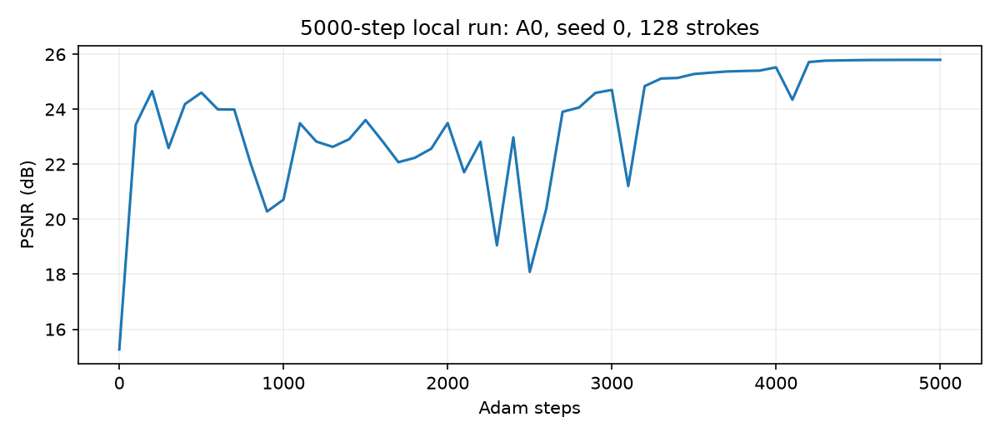

# Results and interpretation

All reported fitting results were obtained on an Apple M4 Pro with 48 GiB unified memory and a 16-core GPU, using macOS 15.7.1, Python 3.12.13, and PyTorch 2.15.0/MPS. [Environment record](../results/environment.json).

## Matched-seed audit comparison

Settings: 128×128 pixels, 128 strokes, 500 Adam steps, no trained initializer. Values below are means across three seeds; the convergence plot shows sample standard deviations.

| Image | Without audit: PSNR | With audit: PSNR | Mean paired difference |
|---|---:|---:|---:|
| A0 | 25.8005 dB | 26.0463 dB | +0.2457 dB |
| L0 | 22.6513 dB | 22.9798 dB | +0.3286 dB |
| P0 | 24.5993 dB | 24.7176 dB | +0.1182 dB |

The table lists means; exact per-run values are in the [CSV](../results/pilot_summary.csv). Across all nine pairs, mean PSNR changes from 24.3504 to 24.5812 dB and mean SSIM from 0.7619 to 0.7681. Mean runtime changes from 22.18 to 22.61 seconds per image.

PSNR increases in eight pairs and decreases in one. P0/seed 2 loses 0.0951 dB; P0/seed 1 loses 0.00394 SSIM. Both cases remain in the aggregate. The small selected sample does not establish statistical significance, broad generalization, or the paper's reported gains.

## Long-run fitting

A0/seed 0 reaches 25.7978 dB PSNR and 0.8290 SSIM after 5,000 steps in 229.72 seconds. The initial PSNR is 15.2644 dB. The selected snapshot is the final step. Intermediate errors fluctuate; convergence is not monotonic. This remains a 128×128, 128-stroke experiment.

A [512×512 rerender](../results/long_A0_512.png) uses the stored stroke geometry without refitting. Fine stray strokes and local artifacts remain visible; higher output resolution does not restore missing image detail.

## Scaling measurements

Synthetic renderer benchmark, forward plus backward with gradient recomputation:

| Canvas | Strokes | Seconds per step |
|---|---:|---:|
| 128×128 | 128 | 0.0710 |
| 256×256 | 250 | 0.2650 |
| 600×600 | 2,000 | 1.8210 |
| 600×600 | 5,000 | 2.9959 |

At the last measured rate, 5,000 renderer steps alone extrapolate to approximately 4.16 hours per image. This excludes other pipeline work and is sensitive to stroke overlap and geometry. It does not validate the paper's efficiency claim. [Raw timing samples](../results/scaling.json).

The 250-query initializer completes five synthetic training steps with finite, nonzero backbone gradients. The last three steps average approximately 0.501 seconds per patch at batch size 1. No full training-time prediction is established because the paper's per-epoch patch count is not known.

## What is established

- The analytic renderer passes independent distance, gradient, compositing, and geometric tests.
- CPU/MPS image and gradient checks have maximum absolute differences of approximately `8.05e-7` and `1.24e-6`, respectively, in the recorded diagnostic.
- The implementation runs on the evaluated Mac and exhibits a small average audit benefit under the documented local protocol.

## What is not established

The paper's complete algorithmic equivalence, trained-model quality, full-resolution results, baseline rankings, LPIPS, all ablations, CUDA speedups, material-rendering results, and user-study conclusions have not been reproduced. See the [completion matrix](method.md#paper-level-completion-matrix).

## Artifact index

| Artifact | Location |
|---|---|
| Per-run configurations, metrics, traces, stroke arrays | [Pilot runs](../results/pilot) |
| Aggregated table and paired changes | [CSV](../results/pilot_summary.csv), [JSON](../results/pilot_summary.json) |
| Long-run outputs | [Long run](../results/long_A0_s0_full) |
| Renderer benchmark | [Scaling JSON](../results/scaling.json) |
| CPU/MPS agreement | [Verification JSON](../results/mps_verification.json) |
| Original numerical tests | [Test record](../results/tests.txt) |
| Initializer diagnostics | [64-pixel diagnostic](../results/training_smoke), [256-pixel diagnostic](../results/training_scale) |

Rebuild summaries with `qbs-report --root results/pilot --out runs/report --no-figures`. Rebuild figures after downloading the three inputs. The release includes measured results, not pretrained weights or raw dataset images.
